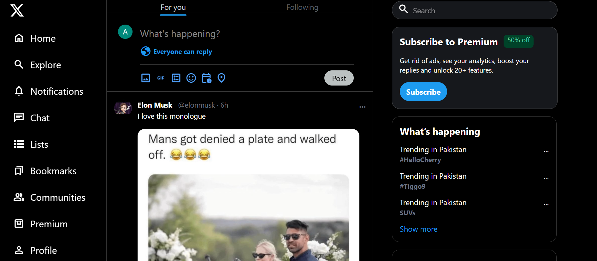

# 🐦 Twitter (X) Clone

A frontend clone of the Twitter (X) web interface, built with HTML and Tailwind CSS. The project focuses on a three-column layout with a fixed left sidebar, a scrollable main feed, and a right sidebar with search, premium, trends and follow suggestions.

🔗 **Live Demo:** [twitter-clone-wllw.vercel.app](https://twitter-clone-wllw.vercel.app)

---

## 📸 Screenshot



---

## ✨ Features

- **Left sidebar navigation:** Home, Explore, Notifications, Chat, Lists, Bookmarks, Communities, Premium and Profile, fixed while the feed scrolls
- **Main feed:** "For you" and "Following" tabs, a "What's happening?" post box, and tweet cards with images
- **Right sidebar:** Search bar, "Subscribe to Premium" card, "What's happening" trends, and "Who to follow" suggestions
- **Dark theme:** Styled to match the X interface
- **Responsive layout:** Works on desktop and tablet screens
- **Custom fonts:** Google Fonts for an authentic Twitter look

---

## 🛠️ Built With

- **HTML5**
- **Tailwind CSS**
- **SVG icons**
- **Google Fonts**
- **Deployment:** Vercel

---

## 📦 Installation & Setup

1. Clone the repository:
   ```bash
   git clone https://github.com/aiyu-dev/twitter-clone.git
   ```
2. Go into the project folder:
   ```bash
   cd twitter-clone
   ```
3. Install dependencies:
   ```bash
   npm install
   ```
4. Run the project (for example with the build script from `package.json`), then open `index.html` in your browser or with the VS Code Live Server extension.

---

## 📚 What I Learned

- Building a complex three-column layout with Tailwind CSS
- Using Flexbox and Grid for precise alignment of icons and text
- Keeping a sidebar fixed while the main feed scrolls
- Adjusting spacing (padding, margin) and styling to match a real interface
- Deploying a frontend project on Vercel

---

## 🎓 Credits

This project is based on [CodeWithHarry's](https://www.youtube.com/@CodeWithHarry) tutorial, which I followed to learn Tailwind CSS.

**My own contributions:**
- Built the third section (the right sidebar, starting from the search bar) on my own
- Made my own code adjustments throughout, including padding, margins and other styling
- Deployed the project on Vercel

---

## ⚠️ Note

This is a portfolio project built for educational purposes. It is not affiliated with Twitter/X Corp. All trademarks belong to their respective owners.

---

## 👩‍💻 Author

**Ayesha Shahzad**
Frontend Developer | Computer Science Student

- GitHub: [aiyu-dev](https://github.com/aiyu-dev)

⭐ If you like this project, consider giving it a star!